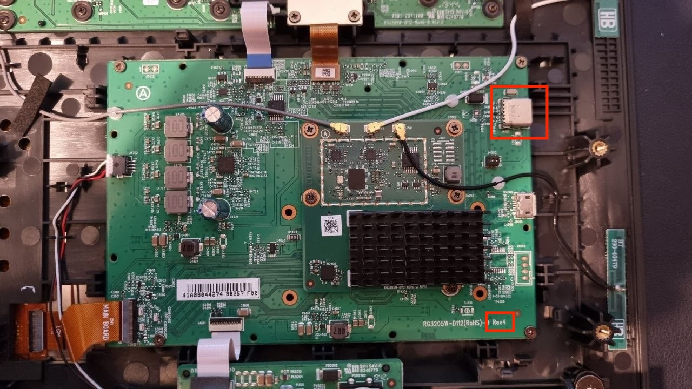
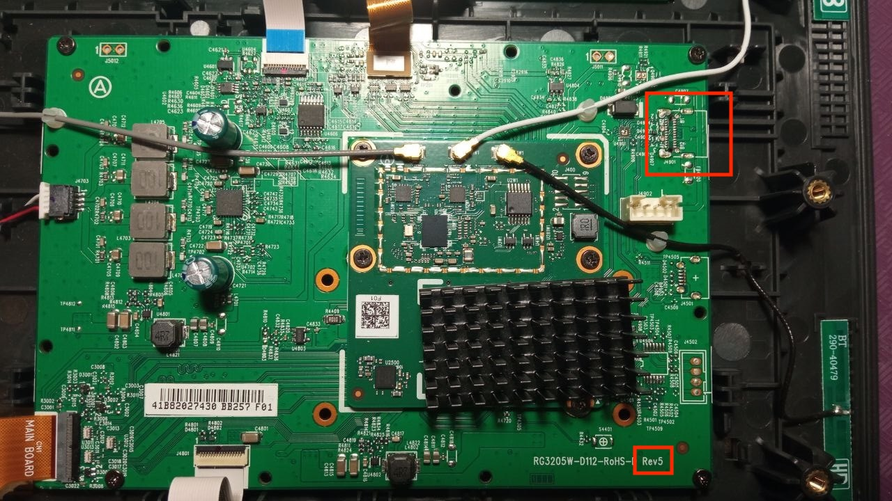
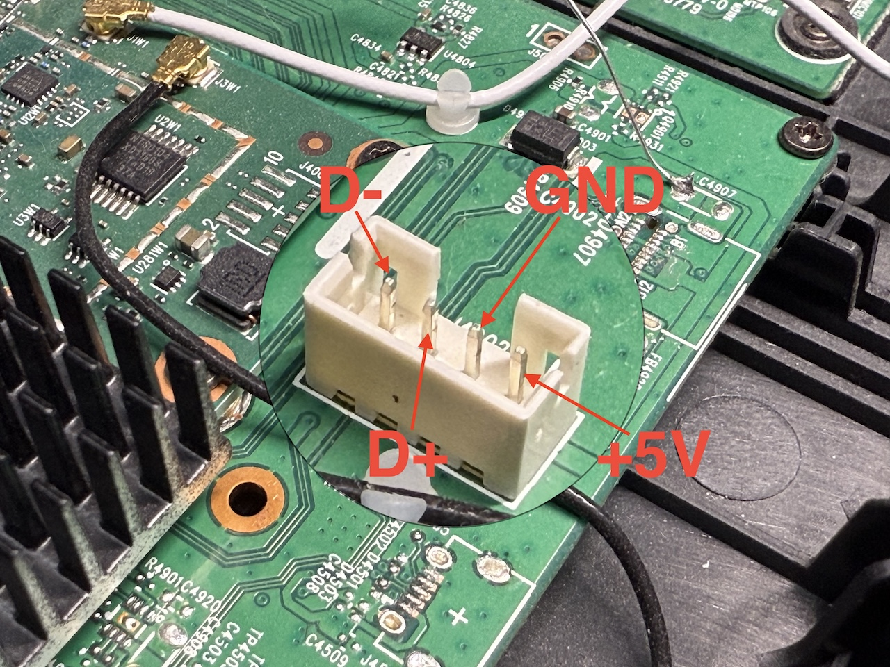

# Reutilización de Movistar Home - RG3205W

como un panel de dashboard para Home Assistant.

**Este documento solo está destinado al modelo `RG3205W` con un SoC arm64 de Qualcomm. Para el modelo `IGW-5000A2BKMP-I v2` con una CPU x86 de Intel, por favor consulta [IGW5000/README.md](../IGW5000/README.md). [_¿Cómo identificarlo?_](../README.md#nota-importante)**

[🇺🇸 English version](./README.en.md)

## Especificaciones

| | |
| --- | --- |
| SoC | Qualcomm Snapdragon 625 (8C8T, Cortex-A53) @ 1,80 GHz |
| OS | Android 8.1.0, kernel 3.18.71-perf, armv7l (32-bit) en lugar de aarch64 |
| RAM | 3 GB |
| Almacenamiento | 32 GB |
| Pantalla | 8 pulgadas 1280x800 con pantalla táctil de I2C de Goodix |
| Wi-Fi & Bluetooth | Qualcomm QCA9379 |
| Altavoces | 2 x 5 W (SPL 87 dB @ 1 W \| 1 m) |
| Micrófonos | 4 micrófonos omnidireccionales con DSP dedicado |
| Cámara | OMNIVISION OV2735 con 2 megapíxeles |
| Medidas | 21,2 x 23,5 x 12,2 cm (alto x ancho x fondo) |
| Peso | 1,1 kg |

## Desmontaje

(Tiene un chasis idéntico al del [IGW5000](../IGW5000/README.md#desmontaje))

Para desmontar el dispositivo, suelta las **10 presillas** _("snap-fits")_ situadas bajo los bordes del panel trasero, teniendo cuidado de no dañarlas.

Luego retira los **8 tornillos** situados bajo el panel y los **4 tornillos** ocultos bajo la tira de goma negra en la parte inferior del dispositivo.

## Modificaciones solo por software

Para información sobre modificaciones solo por software con limitaciones, por favor consulta [rev5-softhacks/README.md](./rev5-softhacks/README.md).

## Flashear una ROM modificada

Afortunadamente, el *bootloader* se puede desbloquear y permite arrancar cualquier ROM modificada. Para hacerlo, puede que necesites improvisar un cable USB, dependiendo de la variante que tengas.

> [!TIP]
> Consulta [daniel1286/home-rom-rg3205w](https://github.com/daniel1286/home-rom-rg3205w) para una ROM LineageOS basada en Android 15 actualizada y métodos de instalación sencillos.

Actualmente existen al menos 2 variantes (revisiones de hardware) del RG3205W: `Rev4` y `Rev5`.

> [!IMPORTANT]
> Para identificar las 2 variantes, **la única forma fiable** es retirar el panel posterior y comprobar las marcas en la placa o la presencia del conector USB Tipo-C.
>
> Se han reportado varias excepciones sobre la fecha de fabricación "F.Fab(AAMM)" en la etiqueta adhesiva, por ejemplo, `2001` puede ser Rev4 o Rev5.

#### Rev4

Si el tuyo tiene una placa `Rev4`, ¡eres muy afortunado! Ya viene con un conector USB Tipo-C hembra soldado y completamente funcional. Solo tienes que conectar un cable normal entre él y tu PC.

#### Rev5

Por desgracia, la variante más común en el mercado es la `Rev5`, que no viene con el conector USB Tipo-C populado.

Sin embargo, el conector JST-PH2.0 blanco hembra con 4 pines que se encuentra cerca (marcado como "J4902") también está conectado a los 4 pines de USB 2.0, con el pinout de izquierda a derecha: `D-`, `D+`, `GND`, `+5V`, puedes usarlo para sacar la conexión USB sin necesidad de soldar un conector SMD de USB Tipo-C (lo cual es muy difícil de hacer).

Puedes improvisar un cable sencillo utilizando un conector JST-PH2.0 macho o un [_pin header_](https://en.wikipedia.org/wiki/Pin_header) hembra de 4 pines con paso de 2,0 mm.

### Entrar al modo EDL

> [!IMPORTANT]
> Se recomienda utilizar el [modo EDL de Qualcomm](https://en.wikipedia.org/wiki/Qualcomm_EDL_mode) para realizar primero un volcado completo de la memoria flash, para que puedas restaurarlo a su estado original si algo sale mal.

Puedes hacer que el dispositivo entre en modo EDL cortocircuitando los pines `D+` y `GND` del USB (por ejemplo, usando una cuchilla o unas pinzas metálicas) mientras conectas el cable de alimentación, manteniendo el cortocircuito durante 3 segundos antes de soltarlo.

Para la variante rev4, puedes cortocircuitar los pines 3 y 6 del conector _pin-header_ con 5 pines marcado como "J4902".

A continuación, puedes usar la herramienta [QPST de Qualcomm](https://qpsttool.com/) en Windows, o mejor aún, la herramienta [edl](https://github.com/bkerler/edl) de B.Kerler (multi-plataforma) para volcar y flashear la ROM.

Se requiere un fichero de _Firehose Programmer_ (_bootloader_ externo), en este repositorio se proporciona uno que funciona en [`RG3205W/firehose.mbn`](firehose.mbn) (SHA256:0e03a8189b7451d1bb81d6fb10efbcefd399623edcb015af45008eedf8fd1298).

También hay unos volcados de ROM original aportados por la comunidad disponibles en la sección [Recursos](#recursos) más abajo.

> [!CAUTION]
> Procede con extrema precaución al flashear ROMs modificadas, ya que podrías dejar el dispositivo inutilizable _(brickearlo)_.
>
> Solo deberías tocar las particiones `boot`, `recovery`, `system` y `vendor`, y borrar `userdata` y `cache` después de flashear.
>
> **NUNCA TOQUES** las demás particiones, especialmente `persist`, `oem`, `modemst*`, etc,. Porque pueden contener los datos específicos del dispositivo, como direcciones MAC, IMEI, datos de calibración, etc.

### Entrar al modo recovery

Para entrar al modo _recovery_, primero apaga el dispositivo.

Mantén pulsados los botones de volumen "+" (subir), volumen "-" (bajar) de la parte superior, y el botón de encendido de la parte trasera (el botón blanco al lado de la toma de corriente) todos juntos, hasta que aparezca la pantalla azul con el logo blanco de Movistar y luego desaparezca quedándose la pantalla en negro (con un poco de retroiluminación), suelta todos los botones inmediatamente.

Ahora, vuelve a mantener pulsado el botón de encendido, haz clic una vez el botón de volumen "+", debería aparecer el menú de recovery.

> [!TIP]
> Si el método anterior no te funciona, intenta desmontar el dispositivo y pulsar los botones directamente sin las piezas de plástico de la carcasa, en caso de que _tengas morcillas en vez de dedos_.

Puedes navegar en este menú con los botones de volumen y seleccionar una opción con el botón de encendido.

### Desbloquear el bootloader

Instala en tu PC las [Herramientas de la plataforma del SDK de Android](https://developer.android.com/tools/releases/platform-tools?hl=es-419) para obtener los comandos `adb` y `fastboot`.

Conecta el dispositivo a tu PC mediante USB, arranca el dispositivo al modo recovery siguiendo la sección anterior, y selecciona la opción "Reboot to bootloader".

Al ejecutar `fastboot devices` deberías ver que el dispositivo está identificado.

Ejecuta `fastboot flashing unlock` y luego `fastboot oem unlock` para desbloquear el *bootloader*.

### Flashear particiones

Ahora puedes flashear imágenes modificadas a las particiones usando el comando
`fastboot flash <partición> <fichero-imágen>`. Por ejemplo, `fastboot flash system system.bin`.

Este repositorio ofrece una ROM modificada basada en la ROM original [`ES_g1.0_RG3205W3.7.0_202209282206`](https://github.com/zry98/movistar-home-hacks/tree/main/RG3205W/stock-rom-dumps/ES_g1.0_RG3205W3.7.0_202209282206), con todas las aplicaciones preinstaladas innecesarias eliminadas, algunas apps útiles añadidas y unas optimizaciones para mejorar el rendimiento y alargar la vida útil del disco eMMC. Puedes encontrarla en la página de [_Latest Release_](https://github.com/zry98/movistar-home-hacks/releases/latest).

> [!NOTE]
> La ROM modificada que se ofrece aquí está basada en una ROM original muy antigua (septiembre de 2022). Si tienes una Rev5 con una actualización más reciente instalada y quieres ayudar a los demás, por favor volcar la ROM original (será suficiente con solo las 3 particiones `boot`, `system` y `vendor`) por modo EDL y compártela en nuestro [grupo de Telegram](https://t.me/movistar_home_hacking) o contacta con el propietario del repositorio [@zry98](https://github.com/zry98).

Después de flashear, reinicia el dispositivo al modo recovery otra vez, selecciona la opción "Wipe data/factory reset" para formatear la partición `userdata`; luego selecciona la opción "Wipe cache partition" para formatear la partición `cache`.

Finalmente, selecciona la opción "Reboot system now" para reiniciar el dispositivo a la ROM modificada.

## Recursos

- [Volcado parcial de la ROM original de Rev4](https://github.com/zry98/movistar-home-hacks/tree/main/RG3205W/stock-rom-dumps/ES_g1.0_RG3205W1.2.4_201912112049) usando ADB, hecho por _Cansi_ en nuestro grupo de Telegram
- [Volcado de la ROM original de Rev5](https://github.com/zry98/movistar-home-hacks/tree/main/RG3205W/stock-rom-dumps/ES_g1.0_RG3205W3.7.0_202209282206) usando el modo EDL, hecho por _P4blo24_ en nuestro grupo de Telegram
